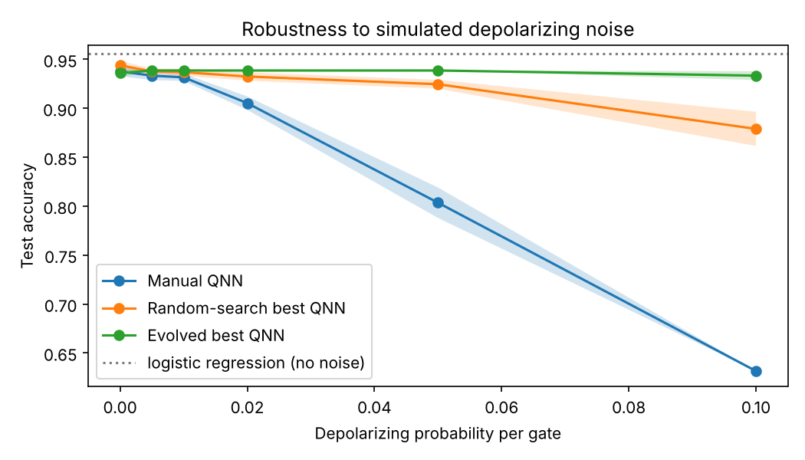

# CircuitPilot-Lite

An exploratory prototype that uses a genetic algorithm to search for small
quantum neural network (QNN) circuits for binary classification. Each circuit
is scored on validation accuracy, circuit complexity, and robustness to
simulated depolarizing noise.

This is a small simulation study (4 qubits, one dataset, one data split). It is
not evidence about real quantum hardware, and no claim of novelty is made.

## Research question

Can an evolutionary search over circuit structure find QNN architectures that
give a better trade-off between accuracy, circuit size and noise robustness
than a conventional hand-designed circuit, under the same data and training
budget? And does the genetic algorithm do better than random search with the
same number of evaluations?

## Motivation

QNN design usually involves choosing the number of layers, which rotation
gates to use and how to entangle qubits by hand. Larger circuits can be more
expressive but accumulate more noise on real devices. Automating the choice
lets us study this trade-off explicitly instead of guessing.

## Method

**Data** (`src/data.py`). The scikit-learn breast cancer dataset (569 samples,
30 features). It is split 60/20/20 into train/validation/test (stratified,
seed 42). The data is then standardized, PCA reduces it to 4 components (79.8%
of the variance kept), and features are scaled to [0, π]. All preprocessing is
fitted on the training split only. Labels are mapped to -1/+1.

**Model** (`src/circuits.py`). There are 4 qubits. The fixed encoding applies
`RY(x_i)` on qubit i. A trainable ansatz follows, and the readout is ⟨Z⟩ on
qubit 0 plus a trainable bias. The prediction is the sign of that value.

**Search space.** An architecture has 1–4 layers. Each layer has one gate per
qubit, chosen from {RX, RY, RZ, none}, and an entangling pattern chosen from
{none, linear CNOT chain, CNOT ring}. Circuits with no trainable gate are
repaired automatically.

**Inner loop: parameter training** (`src/evaluation.py`). Every candidate gets
the same budget: full-batch Adam, 60 steps, learning rate 0.1, squared loss,
initial angles drawn from N(0, 0.1²) with seed 0.

**Outer loop: architecture search** (`src/evolution.py`).
- Population of 12, up to 15 generations, stopping early after 6 generations
  without improvement.
- Tournament selection (k=3), 2 elites kept unchanged.
- Layer-wise one-point crossover (rate 0.5), then one mutation per child. A
  mutation either changes a gate, changes the entangler, adds a layer, or
  removes a layer.
- Every child is validated. Duplicates are avoided in each new population, and
  results are cached so no architecture is trained twice.

**Fitness** (validation data only):

```
fitness = val_acc − w_noise · max(0, val_acc − noisy_val_acc) − w_complexity · complexity
complexity = 0.5 · gates / gates_max + 0.5 · depth / depth_max      (in [0, 1])
```

The noisy accuracy uses depolarizing noise with probability p = 0.02, applied
to every wire after every gate (`default.mixed` simulator). Training is always
noise-free.

**Controls.**
1. Logistic regression on the same 4 features.
2. A hand-designed QNN: 2 layers of RY rotations, each followed by a CNOT ring
   (20 gates, depth 11, 8 parameters).
3. Random search: the same number of unique architectures as the genetic
   algorithm evaluated, scored with the same fitness.

**Final evaluation** (`experiments/final_evaluation.py`). The selected
architectures are fixed. Each is retrained with 10 initialisation seeds on the
same split and budget. It is then tested **once** on the held-out test set at
noise levels p ∈ {0, 0.005, 0.01, 0.02, 0.05, 0.1}. Comparisons are paired by
seed.

## Installation and running

Python 3.11–3.13 (3.12 recommended).

```bash
python -m venv .venv
source .venv/bin/activate          # Windows: .venv\Scripts\Activate.ps1
pip install -r requirements.txt
pip freeze > requirements-lock.txt # record exact versions

python experiments/check_setup.py  # environment smoke test
pytest -q                          # 29 tests, a few seconds

python experiments/run_baselines.py
python experiments/run_search.py --run-name main
python experiments/final_evaluation.py --run-name main
python experiments/make_plots.py --run-name main

# fitness-weight sensitivity run
python experiments/run_search.py --run-name low_complexity --complexity-weight 0.02
python experiments/final_evaluation.py --run-name low_complexity
python experiments/make_plots.py --run-name low_complexity
```

Add `--quick --run-name quick` to `run_search.py` for a run that takes a few
seconds. Each full search took about 1–2 minutes on an ordinary CPU (no GPU). Outputs go
to `results/<run-name>/`:
- `search_summary.json`: configuration, seeds, best circuits and library versions
- `search_history.csv` and `search_candidates.csv`
- `final_results.csv` and `final_summary.json`
- five figures and `best_circuit.txt`

## Metrics

- **Accuracy.** Validation accuracy is used for selection. Test accuracy is
  used only for the final report.
- **Gate count.** All gates, including the 4 encoding gates and the CNOTs.
- **Depth.** The number of sequential gate layers. It is checked against
  `qml.specs` in the tests.
- **Trainable parameters.** These are reported separately. CNOTs add gates and
  depth but no parameters, so the three measures are not interchangeable.
- **Noise degradation.** Ideal accuracy minus noisy accuracy.

## Results

These were produced by the code in this repository with PennyLane 0.45.1 and
Python 3.13. Numbers may differ slightly with other library versions.

### Selection stage (validation set, 114 samples)

| Model | Fitness (w_c = 0.1) | Fitness (w_c = 0.02) | Val acc | Noisy val acc (p=0.02) | Gates | Depth | Params |
|---|---|---|---|---|---|---|---|
| Logistic regression | – | – | 0.947 | – | – | – | 5 |
| Manual QNN | 0.806 | 0.849 | 0.868 | 0.851 | 20 | 11 | 8 |
| Random-search best | 0.855 | 0.890 | 0.904 | 0.895 | 18 | 8 | 8 |
| Evolved best, `main` (w_c = 0.1) | 0.857 | – | 0.868 | 0.868 | 5 | 2 | 1 |
| Evolved best, `low_complexity` (w_c = 0.02) | – | 0.893 | 0.904 | 0.895 | 12 | 5 | 5 |

The `main` search stopped after 11 generations (101 unique circuits). The
`low_complexity` search ran 15 generations (144 unique circuits). Random
search used the same budget in each run and found the same best circuit both
times, because the 101-sample random run is a prefix of the 144-sample one.

### Final test (114 samples, mean over 10 training seeds)

| Model | p = 0 | p = 0.005 | p = 0.01 | p = 0.02 | p = 0.05 | p = 0.1 |
|---|---|---|---|---|---|---|
| Logistic regression | 0.956 | – | – | – | – | – |
| Manual QNN | 0.938 | 0.933 | 0.932 | 0.905 | 0.804 | 0.632 |
| Random-search best | 0.944 | 0.938 | 0.937 | 0.932 | 0.925 | 0.879 |
| Evolved best (`main`) | 0.936 | 0.939 | 0.939 | 0.939 | 0.939 | 0.933 |
| Evolved best (`low_complexity`) | 0.944 | 0.938 | 0.937 | 0.933 | 0.926 | 0.908 |



### What the results show

1. **No QNN beat logistic regression** on clean data: 0.956 versus at most
   0.944. On this 4-feature problem the quantum models offer no accuracy
   advantage.
2. **Without noise, all QNNs are statistically indistinguishable.** The
   largest gap is 0.8 points, which is less than one test sample (1 sample ≈
   0.88 points). With 114 test samples, the binomial standard error of an
   accuracy near 0.94 is about 2.2 points.
3. **Under noise, smaller circuits clearly degrade less.** At p = 0.05 the
   manual QNN loses 13 points. The evolved circuits lose 0–2 points. The
   paired difference against the manual QNN was +0.135 (`main`) and +0.123
   (`low_complexity`), and the evolved circuits won on all 10 seeds. This gap
   is far larger than the seed-to-seed spread. However, it mostly reflects
   that the evolved circuits are much smaller: depolarizing noise here is
   applied per gate, so fewer gates means less noise by construction.
4. **The genetic algorithm did not clearly beat random search.** Its best
   fitness was only 0.002–0.003 higher in both runs. On the test set the
   differences were 0–1.4 points. The `main` run's paired t-test p-values look
   small, but they only capture variation from parameter initialisation. They
   do not capture variation from the choice of test samples, so they should
   not be read as strong evidence.
5. **The fitness weights decide what "best" means.** With w_complexity = 0.1,
   the search chose a 5-gate circuit with one trainable RY on qubit 0. Since
   nothing connects qubit 0 to the others, its output depends **only on the
   first principal component**. It is effectively a one-feature threshold
   classifier, which turns out to be accurate and noise-proof on this data.
   With w_complexity = 0.02, the search chose a 12-gate circuit whose output
   depends on features 0 and 1 only. Its RZ gates and CNOTs on qubits 2–3
   cannot affect the measured qubit. Both facts were confirmed by perturbing
   each input feature and checking whether the output changes.

**Overall:** in this setup, the search mainly rediscovered that a very small
circuit is enough for this dataset, and that small circuits are more robust to
gate-level noise. It did not find a circuit that is more accurate than a simple
classical model or a standard ansatz.

## Limitations

- **One small dataset and one data split.** The test set has 114 samples.
  The seed analysis covers training randomness only, not data sampling.
- **Fitness relies on one training run per candidate (seed 0).** Some ranking
  differences between candidates are within training noise.
- **Simple noise model.** A single-qubit depolarizing channel is applied after
  every gate, with the same probability for one- and two-qubit gates. There is
  no readout error, crosstalk, amplitude damping or device connectivity. Real
  hardware noise is gate-dependent and usually much worse for two-qubit gates.
  The noise is also only applied at inference; circuits are not trained under
  noise.
- **Gate count includes "dead" gates.** Gates outside the measured qubit's
  light cone are counted even though they cannot affect the output.
- **Small search space** (4 qubits, at most 4 layers, CNOT only) and a fixed
  encoding with single-qubit readout.
- Exact statevector and density-matrix simulation, with no shot noise.

## Possible next steps

- Repeat the study over several data splits and search seeds to get proper
  confidence intervals.
- Remove gates outside the measured qubit's light cone before counting
  complexity, or measure several qubits.
- Use a gate-dependent noise model (stronger noise on CNOTs) and try
  noise-aware training.
- Replace the scalar fitness with a Pareto front (accuracy versus gate count
  versus noise drop), for example NSGA-II.
- Use harder datasets where a single principal component is not enough.
- Include data re-uploading in the search space.
